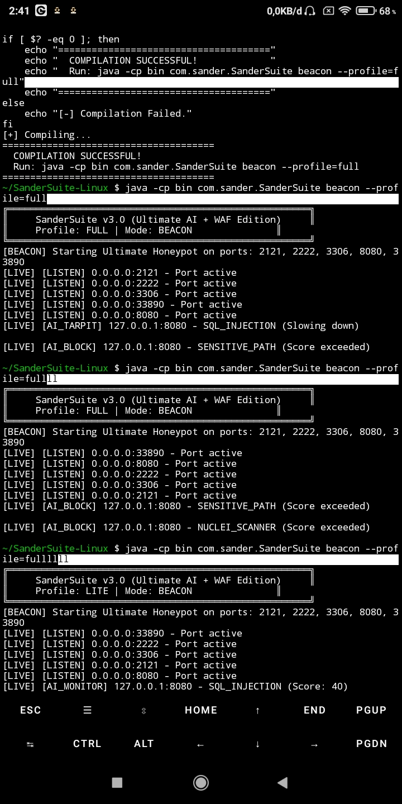
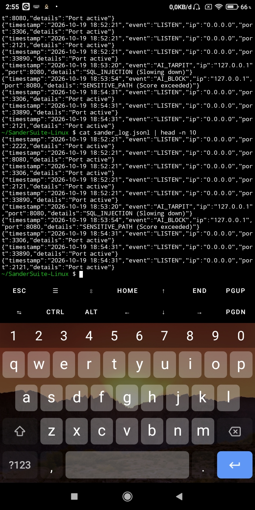

# SanderSuite 🛡️ (Linux Edition)

[](https://github.com/aleksandergrambelik-png/SanderSuite-Linux/actions/workflows/audit.yml)


> All-in-one offensive and defensive security suite for Linux.

> Ultimate AI-Powered Honeypot + WAF (Web Application Firewall) for Linux and Termux.


## 📸 Proof of Concept (Live Test)

SanderSuite was tested live on Termux (Android). The following sequence shows the testing flow in order:

### 1. Attack Simulation 


### 2. AI Detection & Blocking


### 3. Server Initialization


### 4. Structured Logging (JSONL)


> Note: Tested on `127.0.0.1`. IP addresses are partially redacted if necessary.

---

## 🎯 Overview

SanderSuite is a next-generation honeypot and web application firewall designed to detect, trap, and neutralize malicious traffic before it reaches the application layer. It combines AI-based threat analysis, behavioral monitoring, and automated blocking mechanisms to provide proactive defense for Linux and Termux environments.

Built for real-world attack simulation, SanderSuite focuses on identifying malicious patterns such as SQL injection, command execution, XSS, file traversal, scanner behavior, and suspicious obfuscated payloads.

---

## 🛡️ Feature Overview

### 1. WAF Engine

SanderSuite includes a layered web application firewall that inspects inbound requests for common attack signatures and blocks malicious payloads in real time.

- 🔴 SQL Injection (SQLi)
  - Detects payloads such as `UNION SELECT`, `OR '1'='1'`, and similar patterns.
- 🔴 Cross-Site Scripting (XSS)
  - Detects payloads including `<script>`, `javascript:`, and inline handlers such as `onerror=`.
- 🔴 Local File Inclusion (LFI)
  - Detects traversal attempts such as `../../etc/passwd` and similar path manipulation patterns.
- 🔴 Command Injection
  - Detects payloads using `;`, `|`, `&&`, `$()`, and shell-based execution chains.
- 🔴 Sensitive Path Detection
  - Blocks access to sensitive files and directories such as `/.env`, `/.git/`, `/wp-config.php`, and `/actuator`.
- 🔴 Java Injection
  - Detects malicious Java payloads involving `Runtime.getRuntime()`, `ProcessBuilder`, and `System.exit`.
- 🔴 Scanner Detection
  - Identifies bot and automated scanning tools, including patterns such as `Nuclei` and `x-nuclei-id`.

### 2. Anti-Obfuscation and Esoteric Payload Detection

SanderSuite also inspects unusual and obfuscated payloads that are often used to bypass conventional filters.

- 🔴 Brainfuck Payload Detection
  - Detects repetitive esoteric code patterns such as `+ - < > . , [ ]`.
- 🔴 JSFuck Payload Detection
  - Detects heavily obfuscated JavaScript payloads built from `[]()!+` and similar patterns.
- 🔴 Malbolge-Level Obfuscated Payloads
  - Detects payloads so cursed that even the server asks for a prayer.
  - “If a payload looks like it was written by a demonic compiler, this system still logs it.”

### 3. Anti-Scan and Anti-Bot Defense

The system monitors abnormal behavior and flags automated reconnaissance attempts before attackers can gather intelligence.

- 🔴 Port Scan Detection
  - Detects single-source activity that probes multiple ports in a short time window.
- �� Silent Scan Detection
  - Identifies scanners that attempt to probe hosts without sending meaningful payloads.
- 🔴 Reconnaissance Tracking
  - Maintains behavior-based risk scoring for repeated access patterns and suspicious traffic.

### 4. AI Threat Scoring

Every request is evaluated by an AI-based threat scoring engine that assigns a risk score and determines the appropriate response.

- 🟡 Monitor: Score 1–29
  - Requests are logged and minimally challenged.
- 🟠 Tarpit: Score 30–69
  - The connection is intentionally slowed to frustrate the attacker.
- 🔴 Block: Score 70+
  - Malicious IPs are blacklisted automatically.

---

## 🚀 Quick Start

The compiled `.jar` file is already included in the `bin/` folder, so no manual compilation is required.

### Prerequisites

Make sure Java JDK 11+ is installed.

#### Termux (Android)
```bash
pkg install openjdk-17 -y
```

#### Linux / Debian / Ubuntu / Kali
```bash
sudo apt install default-jdk -y
```

### Run the Honeypot
```bash
git clone git@github.com:aleksandergrambelik-png/SanderSuite.git
cd SanderSuite
java -jar bin/SanderSuite.jar beacon --profile=full
```

---

## 🧪 Attack Simulation

Open a new terminal tab and run the following commands.

> Note: Restart the server before each test to reset the AI threat score.

### 1. SQL Injection
```bash
curl --globoff "http://127.0.0.1:8080/?id=1%27%20OR%20%271%27=%271"
```

### 2. Command Injection
```bash
curl --globoff "http://127.0.0.1:8080/?cmd=;cat%20/etc/passwd"
```

### 3. XSS
```bash
curl --globoff "http://127.0.0.1:8080/?q=<script>alert(1)</script>"
```

### 4. LFI
```bash
curl --globoff "http://127.0.0.1:8080/?file=../../etc/passwd"
```

### 5. Sensitive Path
```bash
curl --globoff "http://127.0.0.1:8080/.env"
```

### 6. Java Injection
```bash
curl --globoff "http://127.0.0.1:8080/?exec=Runtime.getRuntime().exec('calc')"
```

### 7. Nuclei Scanner Detection
```bash
curl -A "Nuclei - Open-source project" "http://127.0.0.1:8080/"
```

---

## 🧑‍💻 Contributor Roles

- 💡 Idea, Vision & Architecture: Aleksander
- 🏗️ Core Logic & QA: Aleksander & qwen 3.8
- 🐞 Debugging, Optimization & Code Review: DeepSeek V4.1 Pro & qwen 3.5plus-3.8max
- 📝 Documentation & README: DeepSeek + Aleksander + Copilot

> "I didn't write every line myself. I used AI as a partner, not a replacement. If you think that's 'cheating', that's your problem. We are proud of what we built." 🗿

---

## 📜 License

This project is licensed under the GNU General Public License v3.0.  
See `LICENSE` for details.

---

## 👤 Author

Aleksander (@aleksandergrambelik-png)

Built with ❤️ and too much coffee, from a phone. 📱☕
